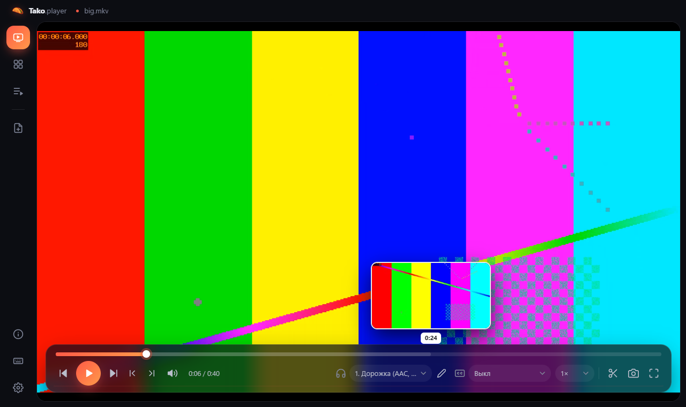
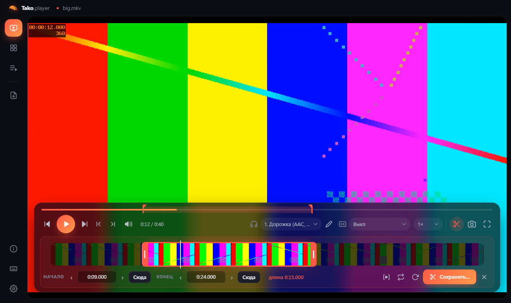
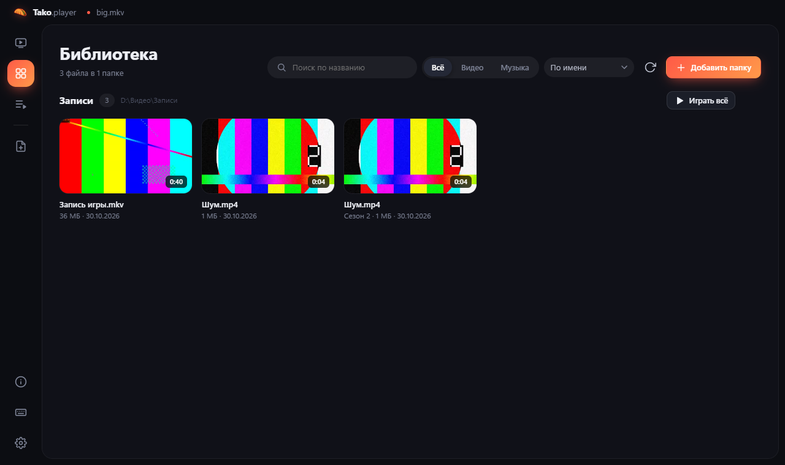
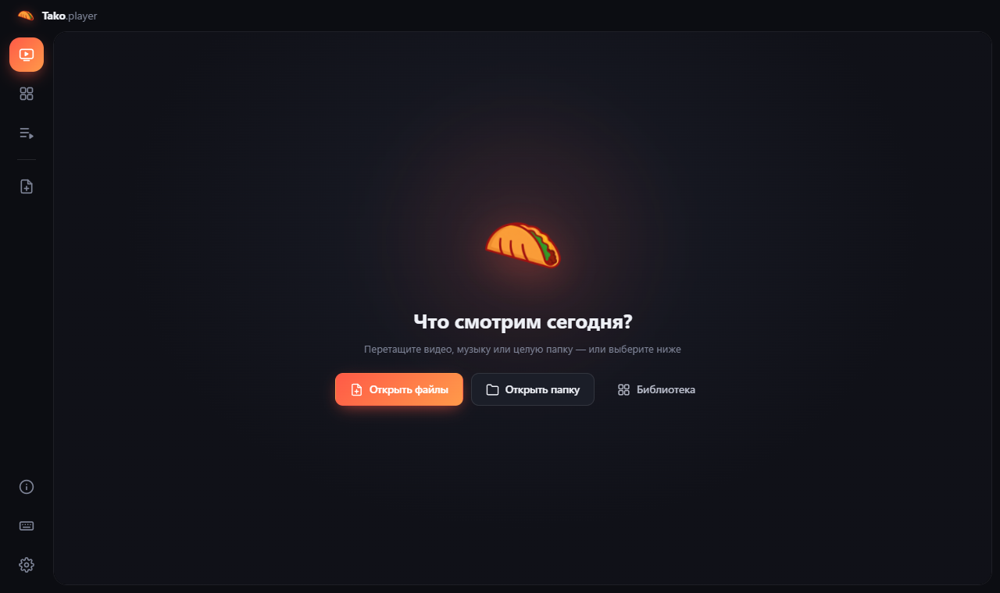
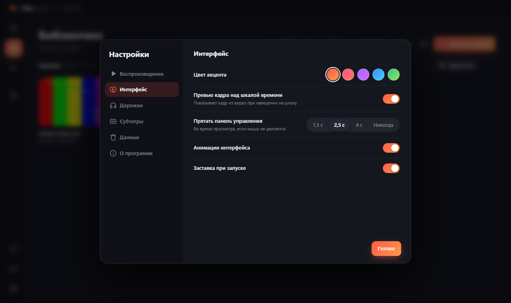

<p align="center">
  
</p>

<h1 align="center">Tako.player</h1>

<p align="center">
  Медиаплеер для Windows, который открывает что угодно, переключает звуковые дорожки на лету<br>
  и режет клипы из записей игр в пару движений.
</p>

<p align="center">
  <a href="https://github.com/soqu4c/Tako.player/releases/latest"><b>⬇ Скачать последнюю версию</b></a>
</p>



## Возможности

**Воспроизведение**
- Открывает почти любые форматы: MP4, MKV, AVI, MOV, WebM, TS, MP3, FLAC и другие. То, что не умеет встроенный движок, плеер на лету готовит через FFmpeg.
- Переключение звуковых дорожек **без остановки картинки** — даже на огромных записях из OBS.
- Субтитры из файла или отдельные `.srt` / `.ass` / `.vtt`, с настройкой размера, цвета и подложки.
- Превью кадра при наведении на шкалу времени.
- Продолжает с места, где вы остановились.

**Обрезка и сохранение**
- Лента с кадрами: тянешь края — выбираешь фрагмент, тянешь середину — сдвигаешь его. Точная подстройка по кадру.
- Сохранение без перекодирования (мгновенно) или точное, с выбором качества или битрейта.
- Можно оставить нужные дорожки, **смешать несколько дорожек в одну** (например, игру и микрофон) или вытащить звук в MP3, M4A, WAV, FLAC.

**Дорожки из OBS**
- Названия дорожек подхватываются из самого файла или прямо из настроек OBS — вместо «Дорожка 1, 2, 3» будет «Игра, Микрофон, Дискорд».
- Свои подписи можно задать для одного файла или сразу для всех записей.

**Библиотека**
- Добавьте папки с видео и музыкой — плеер покажет их карточками с превью, длительностью и тем, сколько вы уже посмотрели.
- «Продолжить просмотр» на стартовом экране, открытие целых папок, перетаскивание файлов в окно.

**Обновляется сам** — новая версия скачивается в фоне и ставится при перезапуске.

| | |
|---|---|
|  |  |
|  |  |

## Установка

1. Скачайте `Tako.player-Setup-….exe` со страницы [Releases](https://github.com/soqu4c/Tako.player/releases/latest).
2. Запустите. У установщика нет платной цифровой подписи, поэтому Windows может показать окно «Система Windows защитила ваш компьютер» — нажмите **«Подробнее» → «Выполнить в любом случае»**.

Нужна Windows 10 или 11 (64-бит). Больше ничего ставить не надо — FFmpeg уже внутри.

## Горячие клавиши

| Клавиши | Действие |
|---|---|
| `Пробел` | Воспроизведение / пауза |
| `←` `→` | Перемотка (Shift — 1 с, Ctrl — 30 с) |
| `,` `.` | Кадр назад / вперёд |
| `A` / `S` | Следующая аудиодорожка / субтитры |
| `T` | Открыть обрезку, `I` / `O` — начало / конец |
| `Ctrl+E` | Сохранить фрагмент |
| `Ctrl+L` | Библиотека |
| `F1` | Все горячие клавиши |

## Для разработчиков

Нужен [Node.js](https://nodejs.org) 20 или новее.

```bash
npm install     # зависимости, включая Electron и FFmpeg
npm start       # запустить из исходников
npm run dist    # собрать установщик в папку dist
```

Код плеера: `main.js` (окно, FFmpeg, файлы, обновления), `renderer.js` (воспроизведение, дорожки, обрезка, сохранение), `ui.js` (библиотека, настройки, превью, интерфейс), `index.html` и `styles.css`.

## Поддержать автора

Если плеер пригодился, можно поддержать автора донатом: **[donationalerts.com/r/whytakao](https://www.donationalerts.com/r/whytakao)** ❤

Кнопка «Поддержать автора» есть и в самом плеере: Настройки → О программе.

## Благодарности

Сделано на [Electron](https://www.electronjs.org). Работа с видео — [FFmpeg](https://ffmpeg.org) (сборки [gyan.dev](https://www.gyan.dev/ffmpeg/builds/) через `ffmpeg-static`, лицензия GPL).
